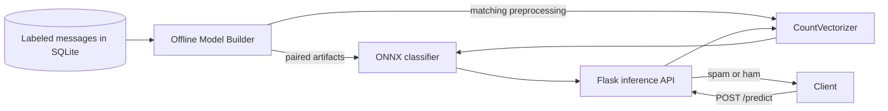

# From Monolith to Model Builder and Inference API

This application separates offline spam-model training from online prediction. It reuses the parent email-detection project's labeled SQLite data and deployable model assets. The inference service loads the ONNX classifier and its matching `joblib` vectorizer; it never starts training when an artifact is missing.

## Architecture



The model classifies each SMS/email message as **spam** (`1`) or **ham** (`0`). The vectorizer and ONNX model are a paired artifact bundle: the vectorizer creates the feature columns expected by the model. Training and serving must use the same pair.

The builder is an offline command, while the Flask app handles online inference. They have separate responsibilities and can run as separate processes. This repository is the first decomposition step; independent deployment and artifact-registry integration can be added as the next step. Prediction is CPU-bound, so asynchronous syntax alone will not make the model run faster.

## Project layout

```text
app/
├── .github/                  # CI setup and lint/test workflow
├── src/
│   ├── api.py                 # Flask HTTP boundary
│   ├── config/                # Pydantic settings and Loguru setup
│   ├── db/                    # SQLAlchemy table and data access
│   ├── model/
│   │   ├── models/            # ONNX classifier and vectorizer
│   │   ├── pipeline/          # Cleaning, training, and export
│   │   ├── model_builder.py   # Offline training service
│   │   └── model_inference.py # Online prediction service
│   ├── runner_builder.py      # Training command
│   └── runner_inference.py    # API command
├── tests/                     # Unit and API tests
├── Makefile
└── pyproject.toml
```

## Setup and run

Requirements: Python 3.11 or 3.12 and Poetry 2.x.

```bash
cd /app
cp .env.example src/config/.env
poetry install --with test,lint
```

Run unit and API tests:

```bash
poetry run pytest
```

Train and export a new model/vectorizer pair from the configured SQLite table:

```bash
poetry run python -m src.runner_builder
```

Start the inference API after the artifacts exist:

```bash
poetry run python -m src.runner_inference
```

The API listens on `http://127.0.0.1:5000` by default. Configuration loads from `src/config/.env` and can be overridden by environment variables. Relative database and artifact paths resolve from the app root; see `.env.example` for the supported variables.

## API

`GET /` returns the service name and endpoint links. `GET /health` reports readiness after both artifacts load. `GET /favicon.ico` returns an empty response so browser requests do not produce 404 logs.

`POST /predict` accepts a batch of one or more messages:

```json
{"messages": ["Can we meet tomorrow?", "Claim your free prize now!"]}
```

Local request example:

```bash
curl -X POST http://127.0.0.1:5000/predict \
  -H 'Content-Type: application/json' \
  -d '{"messages":["Can we meet tomorrow?","Claim your free prize now!"]}'
```

Example response:

```json
{
  "predictions": [
    {"label": "ham", "class_id": 0},
    {"label": "spam", "class_id": 1}
  ]
}
```

Malformed payloads return HTTP 400. Missing model artifacts prevent the API from starting. The built-in Flask server is for local development; use a production WSGI server behind deployment infrastructure when publishing the service.

## Quality commands

```bash
make lint
make test
make check
make train
make api
```
