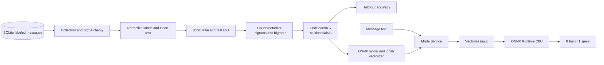

# Spam email classifier

A small, reproducible text-classification pipeline that trains a Multinomial
Naive Bayes model from labeled messages in SQLite, exports it to ONNX, and
serves local predictions through `ModelService`.

## Model contract

The model predicts whether a message is **ham** (ordinary, non-spam text) or
**spam**. Its output is a binary label: `0` for ham and `1` for spam. The
inference service returns labels only; it does not return a confidence score.
This is a spam classifier, not an AI-written-text detector, and it does not
analyze email headers, attachments, or links as separate signals.

The training pipeline cleans message text, maps the configured `Category`
values (`ham` and `spam`) to labels, and drops rows with empty messages or
unknown categories. It uses an 80/20 train/test split, a word-count
`CountVectorizer` with unigrams and bigrams, and a tuned `MultinomialNB`
classifier. The held-out accuracy is logged; the 0.99 threshold currently
produces a warning and does not block artifact export. Treat predictions as
classification assistance, not a guarantee that a message is safe.

## Architecture



`runner.py` loads the saved artifacts and runs sample messages. If either
artifact is missing, `ModelService` triggers model training before loading
them. Training reads the configured SQLite table; `load_data()` also supports
CSV for direct data loading, but the training pipeline currently reads from
SQLite.

## Setup

Requirements: Python 3.11 or 3.12 and Poetry.

From the repository root:

```bash
poetry install --with test
cp .env_example config/.env
```

If `config/.env` already exists, keep it and check that its paths and table
name match your local database and artifacts. The example configuration points
to the checked-in SQLite database, model, and vectorizer.

Run inference:

```bash
poetry run python runner.py
# or
make run
```

Retrain and export artifacts from the configured SQLite table:

```bash
poetry run python -m model.pipeline.model
```

## Quality checks

```bash
make check   # flake8 on application modules
make test    # pytest with coverage; fails below 80%
make runner  # lint, tests, sample inference, then cleanup
```

The test suite includes unit tests and SQLite integration tests. Coverage
reports are printed in the terminal and written to `htmlcov/`.

CI installs the `test` dependency group and runs the same lint and coverage
checks on pushes and pull requests to `main` and `development`.

## Configuration

`config/.env` provides the database and artifact settings:

| Variable | Purpose |
| --- | --- |
| `DB_FILE_NAME` | Existing SQLite database file |
| `DB_URL` | SQLAlchemy connection URL |
| `TABLE_NAME` | Table with `Category` and `Message` columns |
| `MODEL_PATH`, `MODEL_NAME` | ONNX model output and load location |
| `VECTORIZER_PATH`, `VECTORIZER_NAME` | Joblib vectorizer location |
| `LOG_LEVEL` | Loguru log level |
| `DATA_FILE_NAME` | Optional CSV path for the standalone CSV loader |

Keep local configuration in `config/.env`; do not commit credentials or
private data.
