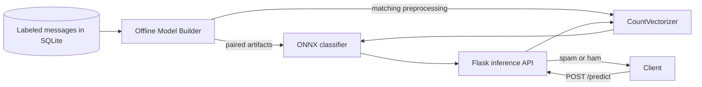

# From Monolith to Model Builder and Inference API

This application separates offline spam-model training from online prediction. It reuses the parent email-detection project's labeled SQLite data and deployable model assets. The inference service loads the ONNX classifier and its matching `joblib` vectorizer; it never starts training when an artifact is missing.

## Architecture



The model classifies each SMS/email message as **spam** (`1`) or **ham** (`0`). The vectorizer and ONNX model are a paired artifact bundle: the vectorizer creates the feature columns expected by the model. Training and serving must use the same pair.

The builder is an offline command, while the Flask app handles online inference. They have separate responsibilities and can run as separate processes. The builder can track runs with MLflow and writes a versioned local bundle containing the ONNX model, its vectorizer, and a manifest with run identity, data counts, metrics, configuration, and SHA-256 checksums. It also refreshes the configured model and vectorizer paths used by the current inference service. Prediction is CPU-bound, so asynchronous syntax alone will not make the model run faster.

## Project layout

```text
app/
├── .github/                  # CI setup and lint/test workflow
├── artifacts/
│   ├── bundles/               # Immutable local bundles by training run
│   └── latest_bundle.json     # Manifest for the most recently published run
├── src/
│   ├── api.py                 # Flask HTTP boundary
│   ├── config/                # Pydantic settings and Loguru setup
│   ├── db/                    # SQLAlchemy table and data access
│   ├── model/
│   │   ├── models/            # ONNX classifier and vectorizer
│   │   ├── pipeline/          # Cleaning, training, and export
│   │   ├── model_builder.py   # Offline training service
│   │   └── model_inference.py # Online prediction service
│   ├── runner_builder.py      # Training command
│   └── runner_inference.py    # API command
├── tests/                     # Unit and API tests
├── Makefile
└── pyproject.toml
```

## Setup and run

Requirements: Python 3.11 or 3.12 and Poetry 2.x.

```bash
cd /app
cp .env.example src/config/.env
poetry install --with test,lint
```

Install the optional MLflow dependency when developing or running tracked training:

```bash
poetry install --with tracking
```

Run unit and API tests:

```bash
poetry run pytest
```

Train and export a new model/vectorizer pair from the configured SQLite table:

```bash
poetry run python -m src.runner_builder
```

MLflow tracking is off by default. Install its dependency group with `make install-tracking`, then set `MLFLOW_TRACKING_ENABLED=true` to record run parameters, held-out metrics, and the versioned artifact bundle. Without an explicit `MLFLOW_TRACKING_URI`, runs are stored in a local SQLite tracking database at `mlflow.db`. Set `DATASET_VERSION` when the source data has a stable snapshot identifier; the builder records row and class counts but never logs message text. The code revision comes from `CODE_REVISION`, `GITHUB_SHA`, or the current Git checkout. `MINIMUM_ACCURACY` is optional and has no default threshold; configure it only after defining an acceptance target for the application. The random seed, test split, and cross-validation folds are configurable in `.env.example`; vectorizer and classifier search settings are recorded in each run and manifest.

### View training runs in the MLflow UI

Enable tracking in `src/config/.env`:

```dotenv
MLFLOW_TRACKING_ENABLED=true
```

Run training to create a tracked run (runs created while tracking is disabled are not added retroactively):

```bash
make train
```

In a second terminal, from the app root, start the UI against the default local tracking database:

```bash
poetry run mlflow ui --backend-store-uri sqlite:///mlflow.db --host 127.0.0.1 --port 5001
```

Open [http://127.0.0.1:5001](http://127.0.0.1:5001) to inspect run parameters, metrics, and artifacts. The UI uses port 5001 so it can run alongside the inference API on port 5000. If `MLFLOW_TRACKING_URI` points to a different tracking store, pass that same URI as `--backend-store-uri` when launching the UI.

Each successful run is copied to `artifacts/bundles/<run-id>/`. The local inference API continues to load `MODEL_PATH` and `VECTORIZER_PATH` by default. Set `INFERENCE_BUNDLE_MANIFEST=artifacts/latest_bundle.json` to load and checksum-verify the latest published bundle, or point it at a versioned bundle's `manifest.json` to select an exact run. The versioned bundle and MLflow run artifacts provide a handoff point for independently deployed inference. Model registration, promotion, and rollback are not enabled yet.

Start the inference API after the artifacts exist:

```bash
poetry run python -m src.runner_inference
```

The API listens on `http://127.0.0.1:5000` by default. Configuration loads from `src/config/.env` and can be overridden by environment variables. Relative database and artifact paths resolve from the app root; see `.env.example` for the supported variables.

## API

`GET /` returns the service name and endpoint links. `GET /health` reports readiness after both artifacts load. `GET /favicon.ico` returns an empty response so browser requests do not produce 404 logs.

`POST /predict` accepts a batch of one or more messages:

```json
{"messages": ["Can we meet tomorrow?", "Claim your free prize now!"]}
```

Local request example:

```bash
curl -X POST http://127.0.0.1:5000/predict \
  -H 'Content-Type: application/json' \
  -d '{"messages":["Can we meet tomorrow?","Claim your free prize now!"]}'
```

Example response:

```json
{
  "predictions": [
    {"label": "ham", "class_id": 0},
    {"label": "spam", "class_id": 1}
  ]
}
```

Malformed payloads return HTTP 400. Missing model artifacts prevent the API from starting. The built-in Flask server is for local development; use a production WSGI server behind deployment infrastructure when publishing the service.

## Quality commands

```bash
make lint
make test
make check
make train
make api
```
